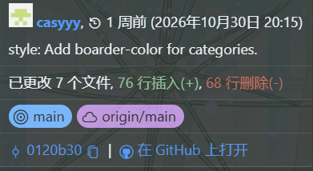
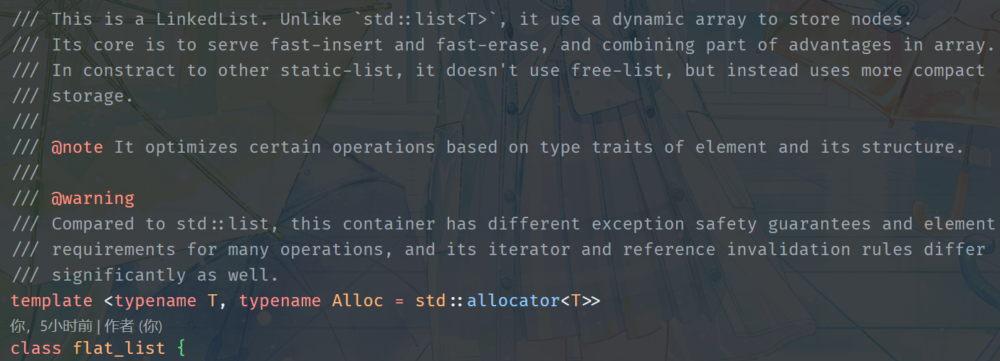
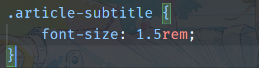
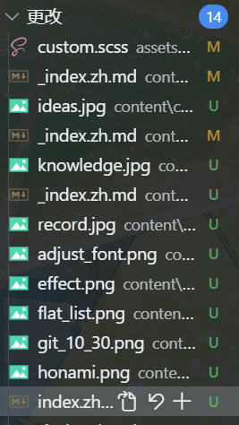

+++
title = "一周的经历"
description = "这一周的变化"
date = 2026-11-07T15:03:13+08:00
image = "honami.png"
math = false
license = "CC BY-NC-SA 4.0"
comments = true
draft = false
toc = true
categories = ["Record"]
tags = ["PersonalRecord"]
slug = "record_1"
+++

## 总起

一周时间没有处理网站了呢……。看上次 Git 提交已经是 10 月 30 号了。

嘛，如果说要找理由还挺多的。虽然一部分确实是自己比较难产是了。这一周也没有什么感觉想写的东西。感觉正处于一个垃圾时间阶段。主要想着写一些 C++ 小东西去了。

之前数据结构课程教授了数组型链表。于是来想法了，打算实现一个基于动态数组版的 `flat_list` ，于是这一周在设计结构（虽然一周时间推翻了好几个设想，属于是觉得不满意推导重来的性格，无论写了多少）。然后写完后自己跑测试，跑基准看看效果。花的还挺久。

然后结合这一周上课，赶作业等这一周就没有细致维护网站了。原本还想继续改造网站，毕竟感觉网站还是一个混沌初始状态。设计的分类区域还没有加上图片。字号还是有点怪怪的。但是感觉一直都没有啥头绪，于是就先搁置了。

感觉自己有一种隐性的完美主义症结？也可能是赶 DDL 式的焦虑。

不过既然在第一篇说了要好好管理，那决定还是要继续做。于是挑了现在来继续美化网站，虽然效果就不清楚了。

## 美化中

这一次的任务不是特别多。主要是修改一下归档页副标题的字体大小，感觉字体有点太大了。改成了 1.5rem。

然后给分类加图片。如果有人比较好奇为什么文章区域习惯用 Project: Sekai 的图片的话……纯粹喜欢罢了（喜欢不需要理由）。至于分类区域则是感觉不是很搭

还有打算设计网页自己的标识的想法，打算针对自己昵称的设计，但是感觉没有一个合自己胃口的设计。就先搁置先把。

最后，就这样。提交。

