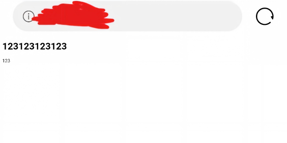

+++
title = "总起"
description = "第一篇博客的碎碎念"
date = "2026-10-23T22:56:00+08:00"
image = 'resonate.jpg'
math = false
license = "CC BY-NC-SA 4.0"
comments = true
draft = false
toc = true
categories = ["想法"]
tags = ["个人思考"]
slug = "the_start"
+++

作为第一篇文章，思考要说什么也是个活。那么就公式点吧，不怎么会组织语言。

## 创站动机

开自己的博客属于是自己想开了。没有特别多的理由。打算开一个博客站记载自己的学习旅途，代码什么的。  

### 一些旧事

在相当久远，大概7年前还是初一的时候，就存在着建一个站的想法。

我也是很有行动力哈，买了自己的域名，买了服务器，启动了WordPress框架啥的。

当时真的打算尝试把自己的个人生活，自己在初中的趣事啥的放在自己的网站。

不过当时对于怎么部署WordPress，对于服务器维护，备案这些的一点都不了解。

而且自己的域名，服务器由于资金有限，只开了一个月。

一个月后自然就烂尾了。当时的WordPress截图也不可考了。不过还是遗留了点东西。

### 前一段时间

这样就持续了差不多到刚上大学，自己又想着真正的建立一个自己的网站，自己下功夫去维护。

于是再一次买了服务器，注册域名，然后想着自己去真正的备案。

然后不出所料地是因为自己比较懒，去年的事情也不少。因此只是买了域名和服务器，然后又烂尾了。

### 现在

当然，建站的想法是一直存在的。于是到了现在，在git起码会用了后，才打算真正去搭建起来。

这次就没有自己购买服务器了，而是用了静态网站，不过注册了自己的真正打算长期维护的域名。

这次开了git仓库，然后就能用hugo和stack来建设了。

现在是成功建设起来了。不过本人对于前端一窍不通，对于怎么给页面布局可能需要学习或者交由Vibe Coding了。请见谅。

## 打算发布什么

早期的建站想着记录自己的生活。不过后面打消了这个念头。

这个站一般记录自己在代码，语言，算法，数据结构，工具链的想法。或者对于知识的收获。

以及可能有一些杂谈。也许可能包括自己玩的游戏杂谈。

也可能会有一些和计算机学科无关的创作小作文？

先保持不确定性吧。

目前主页面的几个栏目不一定是最终分类，可能自己会再分。

## 更新频率

根据是否想写为主，可能想写的时候，一口气产出好几篇。也可能高度难产。

## 其他

看到这里，如果你对这个网站有什么想法的话，可以在关于那一栏联系我，我有时间会去看一下。

每篇文章都允许评论，我能回复的话会去回复的。

> "Expressing all my feelings, saying anything I want to in the afterword."
> ——— *世界の歩き方*
